# Tarazu

A free, open-source tool for settling gold and silver disputes between jewellers and karigars. When the metal that comes back does not match what was given out, Tarazu balances the pure metal and allows for scale and purity error. It then lists the record mistakes that could explain the gap and suggests the quickest check that would settle it.

It never accuses anyone. Metal is "unaccounted for", never "missing", "lost" or "stolen". Both sides see the same screen, and nothing is final until both sign. It works offline, on a phone, in English, Hindi and Punjabi.


## Contents

1. [The problem](#the-problem)
2. [How Tarazu works](#how-tarazu-works)
3. [A worked example](#a-worked-example)
4. [The four ideas inside the engine](#the-four-ideas-inside-the-engine)
5. [Life of a case](#life-of-a-case)
6. [Architecture](#architecture)
7. [Screens](#screens)
8. [Results so far (simulated)](#results-so-far-simulated)
9. [Run it](#run-it)
10. [The Android app](#the-android-app)
11. [Running the physical trial](#running-the-physical-trial)
12. [Tests](#tests)
13. [What is where](#what-is-where)
14. [Honest limits](#honest-limits)
15. [What comes next](#what-comes-next)

## The problem

In jewellery job work, a jeweller gives a karigar a weighed amount of gold or silver. The karigar returns finished pieces, scrap and sweepings, and both sides agree a small loss (wastage) in advance. When the numbers do not match, there is a dispute.

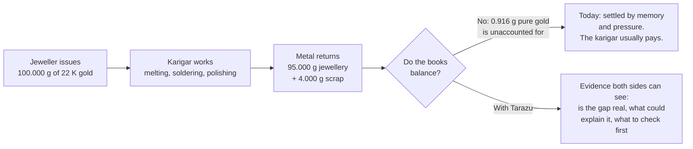

Ledger software today records that the balance is off. It cannot tell whether the gap is real or just scale error, what could have caused it, or what to check first.

| What a dispute needs | Paper ledger | Fixed-tolerance spreadsheet | Tarazu |
|---|---|---|---|
| Separates a real gap from scale and purity error | No | One fixed number | Yes, for every weighing |
| Lists what could explain the gap | No | No | Yes, 9 causes |
| Says which check to do next | No | No | Yes, ranked |
| Same screen for jeweller and karigar | Two copies | No | Yes |
| History cannot be overwritten | Ink only | No | Yes, append-only |
| Wording that never accuses, in Hindi and Punjabi | Depends | No | Yes |

## How Tarazu works

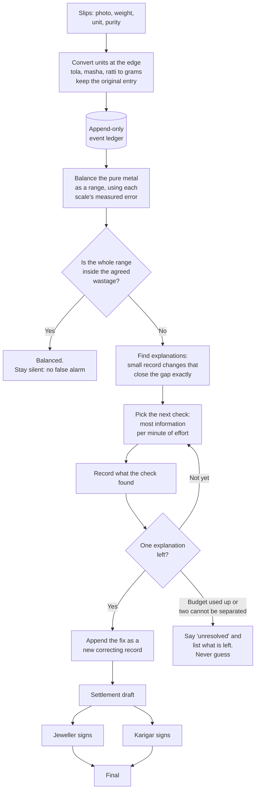

## A worked example

This is the sample case used in the app and in the walkthrough. The figures are illustrative.

| Step | Record | Gross weight | Purity | Pure metal |
|---|---|---|---|---|
| 1 | Issued to karigar | 100.000 g | 0.916 | 91.600 g |
| 2 | Jewellery returned | 95.000 g | 0.916 | 87.020 g |
| 3 | Scrap returned | 4.000 g | 0.916 | 3.664 g |
| | Not accounted for | | | 0.916 g |

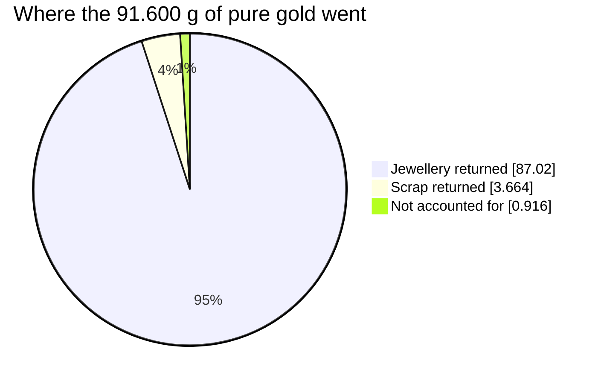

With scale error included, the gap is a range of 0.910 to 0.921 g, and no wastage was agreed, so the gap is real. Tarazu tries 31 possible record changes, and 12 of them close the gap exactly. After four checks one is left: a 1 g item still at the karigar's bench. Recording it as a new entry brings the balance to 0.0000 g.

## The four ideas inside the engine

### 1. Only pure metal has to balance

Copper and other alloy metals change the total weight but not the gold or silver in it. Every record is converted to pure metal:

```
pure metal = net weight × purity
gap = pure issued − pure returned − pure scrap − pure still at the bench − agreed wastage
```

Weights are stored as whole micrograms and calculated with exact decimals. Ordinary floating-point numbers, which can round, are never used for a settlement.

### 2. A gap is a range, not a single number

Every scale has a measured error and every purity test has a known error, so the gap is an interval, not a point.

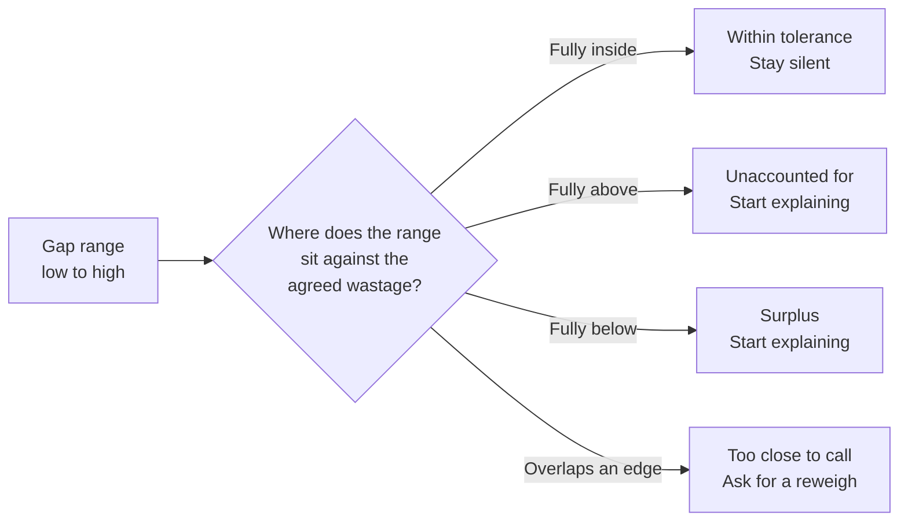

| Case | Gap range | Agreed wastage | Plain ledger | Tarazu |
|---|---|---|---|---|
| Worked example | 0.910 to 0.921 g | none | Alert | Alert, real gap |
| Clean silver job, 50 g | 0.022 to 0.033 g | 0 to 0.046 g | Alert (false) | Silent |

Each scale's error comes from a guided calibration: you weigh a certified weight several times, and the server sets the error as the largest of (bias + 3 standard deviations), the largest single deviation, and the scale's readability.

### 3. Explanations, not accusations

Each explanation is a small, specific change to the records that would close the gap exactly.

| ID | Explanation | Record change | Check that tests it |
|---|---|---|---|
| H1 | A finished piece came back but was not logged | Add a return | Count pieces against the order sheet |
| H2 | Scrap or sweepings were not logged | Add a scrap return | Weigh the scrap bag |
| H3 | Metal is still at the bench | Add a work-in-progress hold | Weigh the item at the bench |
| H4 | A return's purity differs from what was written | Change one purity | Assay that return |
| H5 | A weight was misread or a scale drifted | Shift one weight | Reweigh on a second scale |
| H6 | A unit or typing slip (a tola written as 10 g, not 11.66 g) | Correct one value | Compare the slip photo with the entry |
| H7 | A slip was entered twice | Remove one record | Match timestamps and photos |
| H8 | Stones or fixtures were not deducted | Reduce one net weight | Weigh the stones |
| H9 | Process loss beyond the agreed wastage | None | Offered only after H1 to H8 are ruled out |

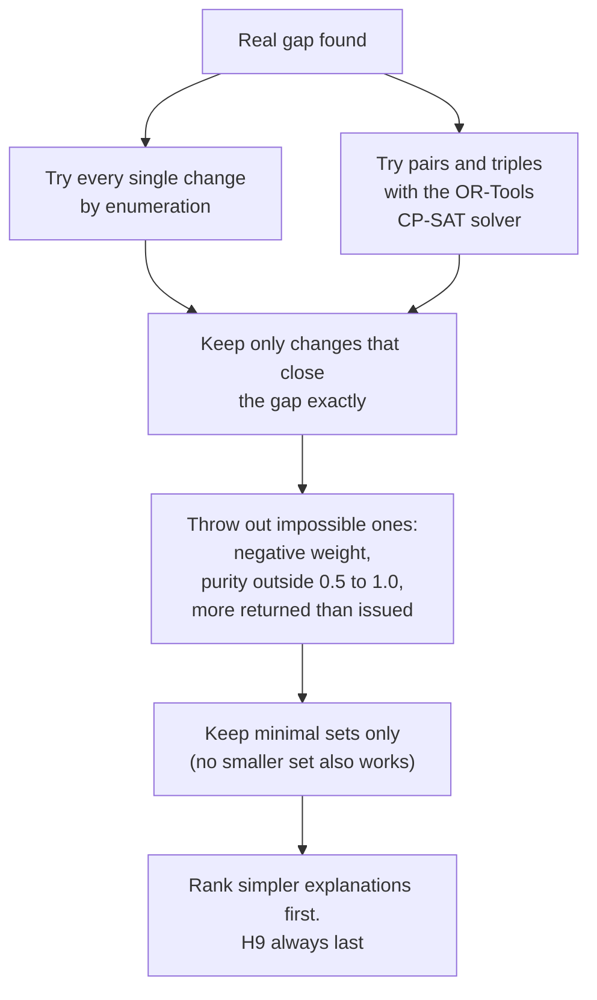

### 4. The cheapest path to the truth

Each check has a cost: its minutes plus a penalty for how awkward it is between the two people. Tarazu picks the check that removes the most doubt for that cost.

```
best check = the check with the highest (expected information gained ÷ cost)
cost = minutes + 3 × friction
```

Ranking for the worked example, from the engine:

| Check | Minutes | Information per unit of cost |
|---|---|---|
| Count finished pieces against the order | 3 | 0.149 |
| Weigh the scrap and sweepings bag | 5 | 0.112 |
| Weigh any item still at the bench | 10 | 0.047 |
| Reweigh a return on a second scale | 4 | 0.024 |
| Compare a slip photo with its entry | 2 | 0.013 |

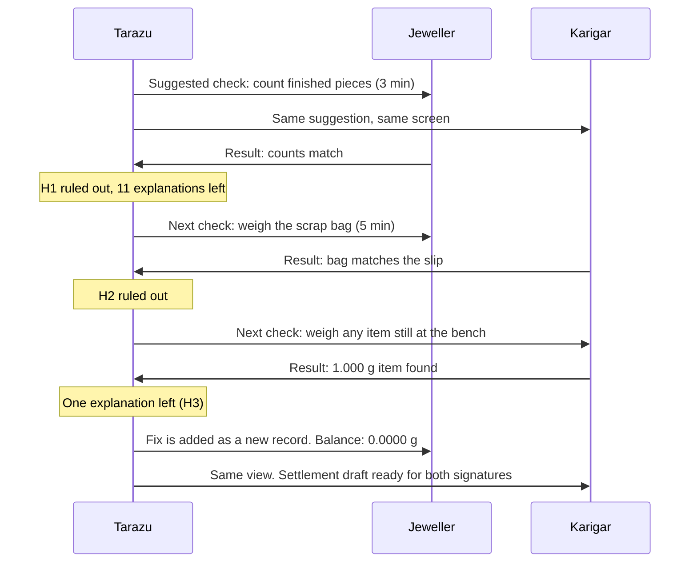

## Life of a case

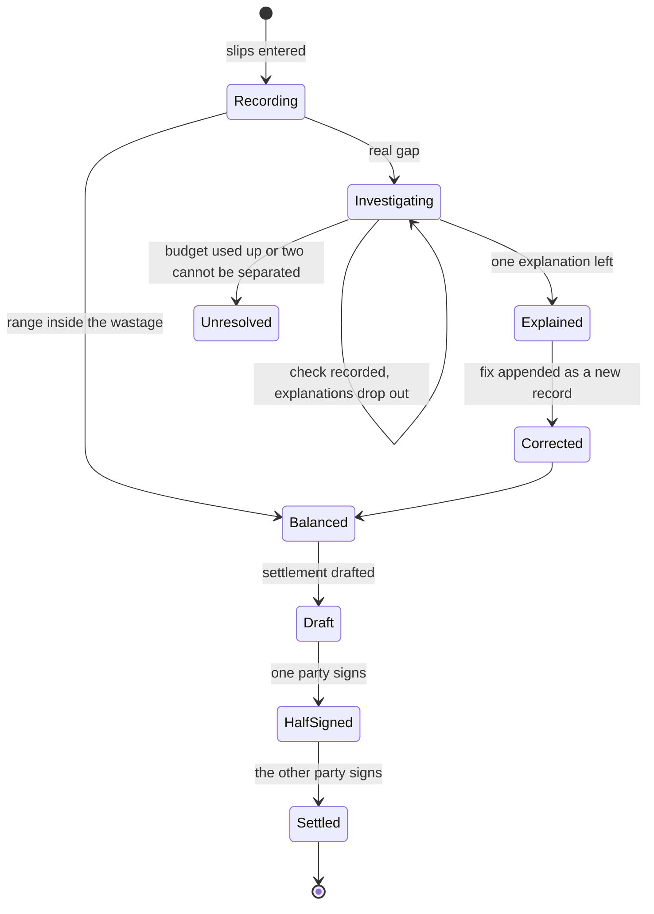

Rules the software enforces:

1. No accusation. The wording checker forbids "missing", "lost" and "stolen" in all three languages, and a test covers it.
2. Same screen. The jeweller and the karigar see the same figures, explanations and suggested check.
3. Own account only. The server refuses a karigar's request for another karigar's jobs.
4. Nothing is overwritten. The database rejects edits and deletions. A mistake is fixed by a correction that points to the record it fixes, with a reason.
5. Settlements are drafts until both parties sign.
6. No AI model does arithmetic. Every balance comes from exact decimal code.
7. Simulated data is labelled as simulated on screen and in every result.

## Architecture

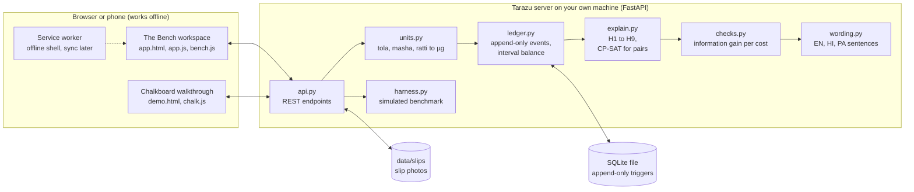

Nothing is sent to a cloud service. There is no account and no tracking. The only outside requests are for web fonts, which are cached after the first visit.

### Main API endpoints

| Method and path | What it does |
|---|---|
| `POST /api/quick` | Analyse a set of slips without saving them (used by the walkthrough and replay) |
| `GET /api/jobs`, `POST /api/jobs` | List or create jobs |
| `GET /api/jobs/{id}` | Full analysis of a job: balance range, explanations, next check |
| `POST /api/jobs/{id}/events` | Append a record |
| `POST /api/events/{id}/approve` | Confirm a record as jeweller or karigar |
| `POST /api/jobs/{id}/checks` | Record what a check found |
| `POST /api/jobs/{id}/apply` | Append the fix for the remaining explanation as a correcting record |
| `POST /api/jobs/{id}/settlements`, `POST /api/settlements/{id}/approve` | Draft a settlement and sign it |
| `POST /api/instruments/{id}/calibrate` | Work out a scale's error from repeat weighings |
| `POST /api/documents` | Upload a slip photo |
| `GET /api/parties/{id}/export` | A karigar exports his own account (JSON or CSV) |
| `POST /api/harness/run` | Run the simulated benchmark |

## Screens

| The workshop | The bench, case resolved |
|---|---|
|  |  |
| Every job is placed on a spectrum by its gap. Drag across it to filter. Each card's balance tilts by that job's real gap. | Each record is a weight on its pan, and the missing metal is a dashed outline. Record the evidence and the beam levels. |

| Preview an explanation | Step through the records |
|---|---|
|  |  |
| Pick an explanation to see the balance as if it were true. Nothing is recorded and nobody is blamed. | Replay the records in order to see where the gap appeared. Each step is recalculated by the engine. |

| Check card | Two signatures |
|---|---|
|  |  |
| The card flips over to record what the check found. | Each party signs a wax seal. The settlement is final only after both have signed. |

| Scale calibration | On a phone |
|---|---|
|  |  |

### The guided walkthrough, in seven steps

The chalkboard walkthrough at `/demo.html` explains one full dispute. Every number on it is computed by the engine, and it switches between English, Hindi and Punjabi.

| 1. The job, from the slips | 2. Only pure metal counts | 3. The gap: 0.916 g |
|---|---|---|
|  |  |  |

| 4. Real gap, not scale error | 5. 12 explanations fit | 6. The most useful next check |
|---|---|---|
|  |  |  |

| 7. Words that never accuse | The same board in Hindi |
|---|---|
|  |  |

## Results so far (simulated)

These numbers come from a simulated workshop with faults inserted at random (seed 2026). They are not from real weighings, and real accuracy will come from the physical trial.

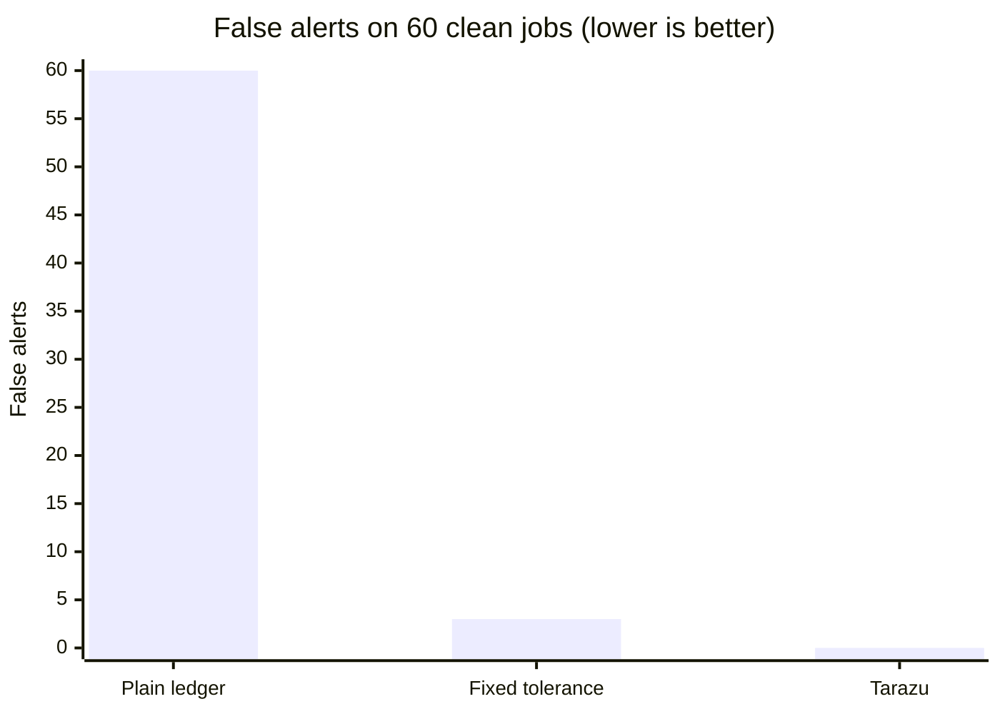

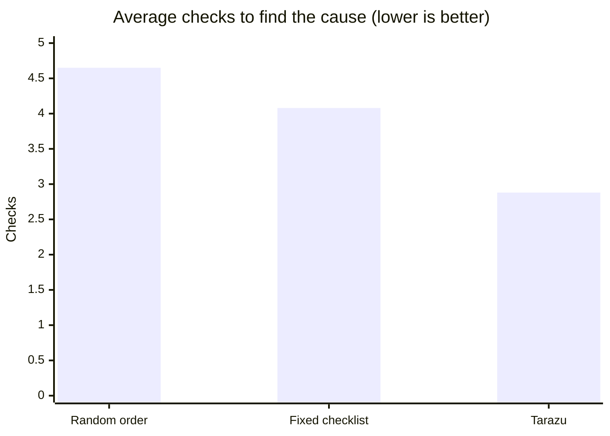

| Measure | Result |
|---|---|
| False alerts on 60 clean jobs | 0 (95% upper bound 4.9%) |
| True cause included in the explanations | 86 of 87 fault cases |
| Checks to find the cause | 2.88, against 4.08 for a fixed checklist (29% fewer) |
| Detection by size of fault | 100% at 2× scale error or more, silent at 0.5× |
| Two-fault cases answered confidently wrong | 0 of 10 |
| Time to analyse a 30-record job on a laptop | 0.55 s, checking every one of its 16,051 possible explanations |

## Run it

```
pip install -r requirements.txt
python run.py
```

| Address | What opens |
|---|---|
| http://127.0.0.1:8000 | The landing page |
| http://127.0.0.1:8000/app.html | The workspace. On an empty workspace, press Load sample workshop to add five sample jobs, each labelled Sample. |
| http://127.0.0.1:8000/demo.html | The chalkboard walkthrough |

Keyboard shortcuts in the workspace: Ctrl K opens the command palette, ? lists all shortcuts, and g then j, i, e or s jumps between pages.

## The Android app

Tarazu also runs as an installable Android app that needs no server and no internet. The phone runs the same Python engine as the server, compiled to WebAssembly, so there is one engine and one set of tests.

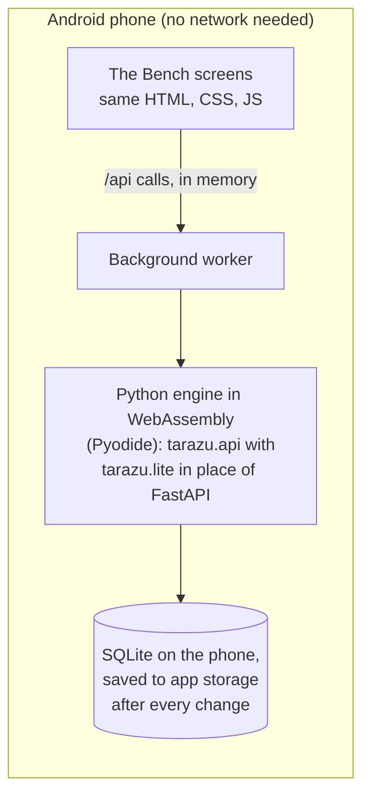

How it stays fast and small:

1. The engine and its pure-Python libraries are precompiled to bytecode in one 3.8 MB archive, so the phone never compiles source code at start-up.
2. FastAPI is not shipped. `tarazu.lite` is a small in-process dispatcher that runs the same endpoint functions and pydantic validation. The whole API test suite runs against it as well as against FastAPI, so both give the same answers.
3. Only two compiled packages are loaded (SQLite and pydantic-core). The app is about 20 MB.
4. The engine runs in a background worker, so the screen never freezes. The walkthrough opens inside the app and reuses the running engine.
5. Fonts are bundled. A content security policy stops the pages from contacting anything outside the phone.

Build it:

```
cd mobile
npm install
npm run build        # builds mobile/www and syncs it into the Android project
npm run open         # opens Android Studio; or: cd android && ./gradlew assembleDebug
```

You need Python 3.12, Node 22 and, for the APK, Java 21 and the Android SDK. Without a local Android SDK, push to GitHub: the workflow in `.github/workflows/android.yml` runs every test, builds the APK and attaches it to the run as `tarazu-android-apk`.

## Running the physical trial

`backend/tarazu/trial.py` is the toolkit for the real benchmark in protocol sections 5 to 8. It works on a folder of plain CSV sheets, so the people at the bench can fill them in with any spreadsheet program.

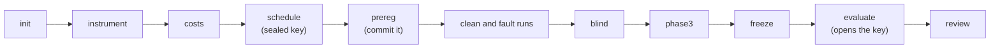

| Command | What it does |
|---|---|
| `init` | Creates every sheet: runs, records, ground truth, instrument readings, costs, joint review, consent, payment, data ledger |
| `instrument` | Phase 0: each scale's uncertainty, drift, linearity, tare effect and day-to-day spread, with warnings when the data is thinner than the protocol asks |
| `costs` | Builds the check-cost profile from the jeweller's and the karigar's separate ratings |
| `schedule` | A random, blind fault schedule. The key is sealed and its SHA-256 published, so it cannot be changed afterwards unnoticed |
| `prereg`, `verify` | Pre-registration of metrics, thresholds, the development split and a fingerprint of the engine code. `verify` fails if anything changed |
| `blind` | Runs Tarazu on the visible records only and stores each output with the code version |
| `phase3` | Record-level faults (transcription, duplicates, unit mix-ups, pairs, cancelling faults, malformed entries) on copies of clean runs |
| `freeze`, `evaluate` | Freezes the test set, then opens the key only if every integrity check passes, and scores every pre-registered criterion with exact intervals |
| `review` | Phase 4: whether the jeweller and the karigar each read the screen correctly |
| `simulate` | Fills a workspace with simulated data so the whole pipeline can be practised first |

The step-by-step guide, materials checklist, safety notes and consent scripts in English, Hindi and Punjabi are in [docs/trial](docs/trial/TRIAL_GUIDE.md).

## Tests

```
cd backend
python -m pytest -q
```

58 tests pass. They cover:

1. The worked example above.
2. Pure metal being conserved over random sequences of records (property-based tests with Hypothesis).
3. A gap inside the error range never being flagged.
4. One test for each fault type F1 to F9.
5. Explanations being minimal and physically possible.
6. The exhaustive search finding exactly the minimal explanations, and agreeing with CP-SAT.
7. Check selection, including saying "unresolved".
8. The no-accusation wording rule in all three languages.
9. The database refusing edits and deletions.
10. A karigar being unable to see another karigar's jobs.
11. The full flow: issue, check, fix, two-sided settlement, and slip photo upload.
12. The whole API suite again through the app's in-process dispatcher.
13. The trial toolkit: sealed keys, pre-registration checks, refusal to open a tampered key, and a full simulated dry run.

## What is where

| Path | What it does |
|---|---|
| `backend/tarazu/units.py` | Converts tola, masha, ratti and g to whole micrograms |
| `backend/tarazu/ledger.py` | Append-only events, corrections replayed, gap as a range with the agreed wastage |
| `backend/tarazu/explain.py` | H1 to H9 as record changes; an exact, exhaustive search for minimal sets of up to three, with OR-Tools CP-SAT for very large searches |
| `backend/tarazu/checks.py` | Information gain per unit of cost; stop, confirm or say unresolved; simulator for the baselines |
| `backend/tarazu/wording.py` | English, Hindi and Punjabi sentences; list of forbidden words |
| `backend/tarazu/harness.py` | Simulated workshop, random fault insertion, baselines, size sweep |
| `backend/tarazu/api.py` | FastAPI server; also serves the frontend |
| `backend/tarazu/lite.py` | The app's in-process stand-in for FastAPI |
| `backend/tarazu/instrument.py` | The scale-uncertainty rule and the Phase 0 instrument study |
| `backend/tarazu/trial.py` | The physical-trial toolkit |
| `frontend/app.html`, `assets/js/app.js`, `assets/css/app.css` | The Bench workspace |
| `frontend/assets/js/bench.js` | Interactive balances, the gap spectrum and the case balance |
| `frontend/demo.html`, `assets/js/chalk.js` | The chalkboard walkthrough |
| `frontend/index.html`, `assets/js/landing.js` | The landing page |
| `frontend/assets/js/speech.js` | Reads on-screen sentences aloud |
| `frontend/assets/js/tour.js` | Guided tour of the workspace |
| `frontend/sw.js` | Offline shell for the web version |
| `frontend/assets/js/engine-worker.js` | Runs the Python engine on the phone |
| `mobile/` | The Android app (Capacitor); `tools/build_mobile.py` builds its web bundle |
| `docs/trial/` | Trial guide and consent scripts |
| `pitch-deck/` | Pitch deck (HTML and PDF) and the screenshots used above |

The frontend is plain JavaScript modules with no build step.

## Honest limits

1. All results so far come from a simulated workshop. Real numbers will come from the physical trial.
2. The chatbot-only and human-expert comparisons have not been run yet.
3. There is no login. The view switcher picks jeweller or karigar, and the server checks which jobs a karigar may see, but that is not authentication. This is enough for a single-workshop pilot, not a multi-shop service.
4. Explanation scores are relative rankings that favour simpler explanations. They are not calibrated probabilities, and the interface labels them that way.
5. Two errors that cancel out (one weight too high, another too low by the same amount) cannot be seen by design.
6. Some help text is in English only, and the Hindi and Punjabi need review by native speakers.
7. The Android app has been tested in Chromium with phone settings, not yet on a physical phone. Its first start takes a few seconds while Python loads; after that each analysis takes well under a second.

## What comes next

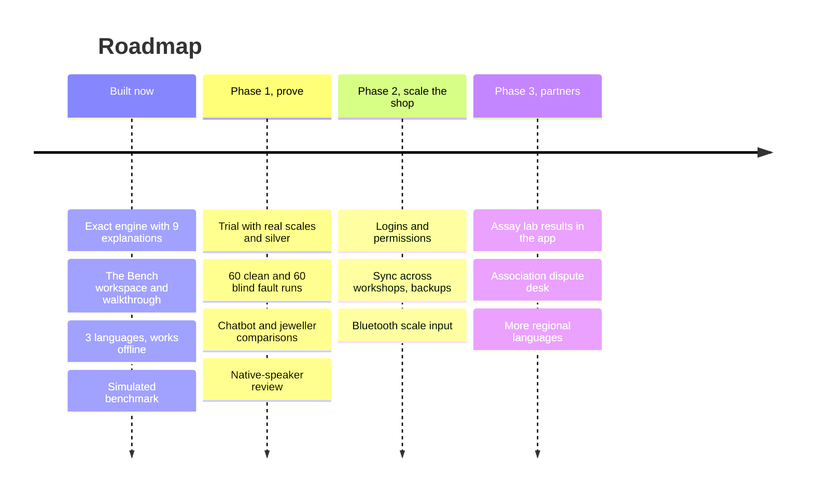

In the trial, a third person inserts the faults so that the analyst does not know which fault is in which run. The weighed dataset will then be released. As far as we know, it would be the first public dataset of karigar disputes.
