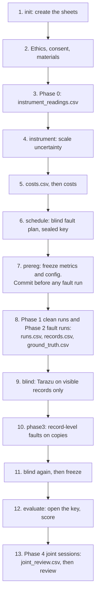

# Running the physical trial

This guide covers protocol tasks 1 to 15: everything that has to happen before and during the trial. Software does the record keeping, the blinding, the pre-registration and the scoring. People do the weighing, the consent and the sessions.

All commands run from the `backend` folder:

```
python -m tarazu.trial <command> <workspace>
```

The workspace is a folder of plain CSV sheets, which you can open and fill in with any spreadsheet program. Keep it in its own private repository, separate from the code.

## Order of work



To practise the whole sequence with simulated data first:

```
python -m tarazu.trial simulate ../trial-practice
python -m tarazu.trial prereg ../trial-practice --dev S01 S02 S03 S04 S05
python -m tarazu.trial blind ../trial-practice
python -m tarazu.trial phase3 ../trial-practice
python -m tarazu.trial freeze ../trial-practice
python -m tarazu.trial evaluate ../trial-practice
```

Every simulated file and result is labelled SIMULATED.

## Task by task

| # | Task | Who | Tool or sheet |
|---|---|---|---|
| 1 | Version control | You | Done: the code is on GitHub. Keep the trial workspace in a separate private repository. |
| 2 | Pre-register metrics and thresholds | You | `prereg` writes `PREREGISTRATION.md` and `prereg.json` with a fingerprint. Commit both (or upload them to OSF) before any fault run. |
| 3 | Freeze decision rules on a development split by session | You | `prereg --dev S01 S02 ...` records which sessions are development. `verify` fails if the code or config has changed since. |
| 4 | Blinding | A third person | `schedule` writes `schedule.csv` (visible to everyone) and `sealed/fault_key.csv` plus `sealed/injector_sheet.md` (third person only). The key's SHA-256 is published in `schedule_commitment.json`, so it cannot be changed afterwards without detection. |
| 5 | Check costs from a real jeweller and karigar | Both parties | Each fills `costs.csv` separately: minutes and friction (0 to 5) for each check. `costs` builds the profile and warns about any check rated by only one side. |
| 6 | Ethics approval | You | Use [CONSENT.md](CONSENT.md) as the study description for your institution's ethics committee. |
| 7 | Consent, payment, safety | You | Read the scripts in [CONSENT.md](CONSENT.md) aloud. Log each person in `consent_log.csv` and each payment in `payment_log.csv`. Follow the safety list below. |
| 8 | Materials | You | The checklist below. |
| 9 | Phase 0 instrument study | You | `instrument_readings.csv`: 30 readings per check weight, per scale, over 3 days. `instrument` reports each scale's uncertainty, drift, linearity, tare effect and day-to-day spread, and warns when the data is thinner than the protocol asks. |
| 10 | Phase 1: 60 clean runs | You and the karigar | `runs.csv` (phase `clean`), `records.csv`, `ground_truth.csv` |
| 11 | Phase 2: 60 blind physical faults | Third person injects | Run the rows of `schedule.csv` in order. The injector writes the record number changed (F4, F5, F6) and the actual size in `sealed/injection_log.csv`. |
| 12 | Phase 3: 40 record-level faults | Software | `phase3` copies clean test-session runs and applies F7, F8, F9, pairs, cancelling faults and malformed entries, with its own sealed, committed key. |
| 13 | Magnitude sweep | Third person | Included in `schedule`: F1, F2, F3 and F5 at 0.5, 1, 2, 5 and 10 times the measured uncertainty, with sizes in grams already worked out. |
| 14 | Adversarial cases | Software and the third person | Clean controls are mixed into the fault schedule. Indistinguishable pairs (1.000 g unlogged scrap versus 1.000 g at the bench) are scheduled. Cancelling and malformed cases come from `phase3`. Near-duplicate slips need two genuine equal returns: record them when they happen and note it in `runs.csv`. |
| 15 | Phase 4 joint sessions | Jeweller and karigar | Use the questionnaire below, fill in `joint_review.csv`, then run `review`. The pass mark is at least 8 of 10 correct for each role. Trust ratings are descriptive only. |

## Sheets

| Sheet | One row per | Filled by |
|---|---|---|
| `runs.csv` | Run: session, date, operator, phase, task, agreed wastage, expected pieces | Analyst |
| `records.csv` | Slip line, exactly as written: type, value, unit, fineness, scale, assay method | Analyst, from the slips |
| `ground_truth.csv` | Run: true fine metal not recovered, from the sealed ground-truth sheet | Third person (never shown to the analyst) |
| `instrument_readings.csv` | Reading of a check weight | Analyst |
| `costs.csv` | Rating of a check by one person | Jeweller and karigar, separately |
| `sealed/injection_log.csv` | Fault run: record changed, actual size | Third person |
| `joint_review.csv` | Answer from one person about one case | Session lead |
| `consent_log.csv`, `payment_log.csv`, `data_ledger.csv` | Person, payment, data source | You |

Event types in `records.csv` are `ISSUE`, `ALLOY_ADD`, `RETURN_FINISHED`, `RETURN_SCRAP`, `WIP_HOLD` and `STONE_SET`. Units can be `g`, `mg`, `tola`, `masha` or `ratti`, and the value is entered exactly as written on the slip. `phase` is `clean` for Phase 1 runs and `fault-or-control` for scheduled runs.

## Integrity rules the software enforces

1. `evaluate` refuses to open the key if there is no pre-registration, if the test set was not frozen, if any frozen file changed afterwards, or if a key file does not match its published commitment.
2. `evaluate` also refuses if the engine code or frozen config changed since pre-registration. `--allow-changed` overrides this, but the report then prints every change at the top.
3. B1 (fixed tolerance) is tuned on development-session clean runs only.
4. Results are reported per class with denominators and exact 95% bounds. There is no single headline accuracy.

## Materials checklist

- [ ] Two scales with 0.001 g readability
- [ ] Certified check weights of 10 g, 50 g and 100 g, with their certificate
- [ ] Brass or copper blanks for practice runs
- [ ] Certified 999 fine silver, and copper for making 925 by known mass additions
- [ ] Silver solder of known fineness
- [ ] Slip books in the karigar's usual format, and a phone for slip photos
- [ ] A bench tray, labelled sweepings bags and sealed bags for each piece
- [ ] Access to XRF or a karat meter (hallmarking centre or jeweller) for a subset of pieces
- [ ] Masks, wet-cleaning cloths or dust extraction
- [ ] Sealable envelopes for the ground-truth sheets and the injector sheet

## Safety

- Filing and buffing silver makes fine dust. Wear a mask, use extraction or wet cleaning, and never sweep dry.
- Do melting only if the karigar has a proper furnace and the metal can be collected safely.
- Store fine silver locked away, and log every gram in and out of storage.

## Phase 4 questionnaire

The session lead shows one case on Tarazu, then asks each person separately:

1. How much fine metal is unaccounted for? (Write the figure in grams in `stated_unaccounted_g`.)
2. What should be checked next? (Write the check in `stated_next_check`, using one of: `count_pieces`, `weigh_scrap_bag`, `weigh_bench`, `assay`, `reweigh`, `photo`, `dup_match`, `weigh_stones`.)
3. From 1 to 5, how much do you trust this screen to treat both of you fairly? (Write it in `trust_1_to_5`.)

Hindi and Punjabi wording for these questions is in [CONSENT.md](CONSENT.md).
